<!-- Perfil visual: editar paneles en assets/*.svg. -->

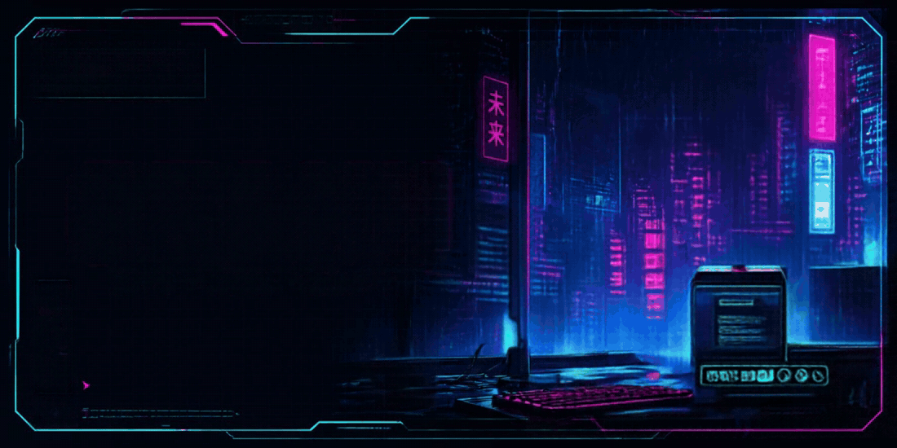

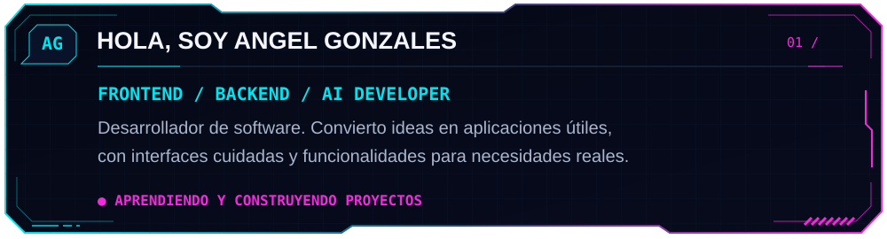

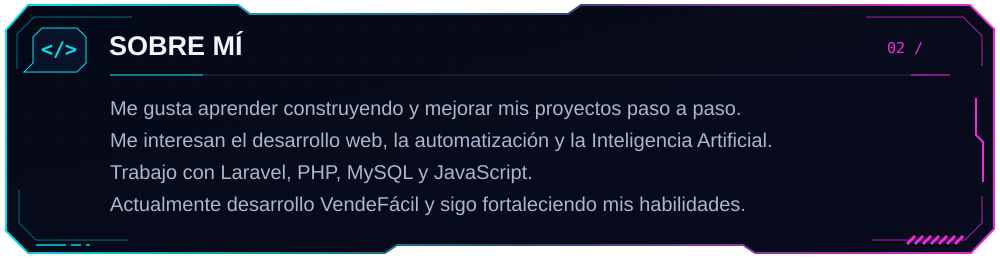

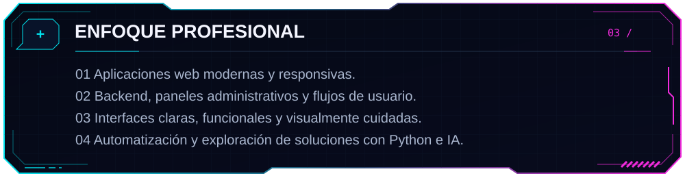

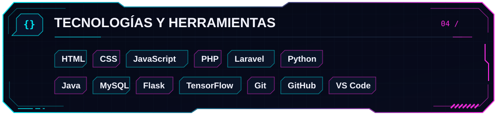

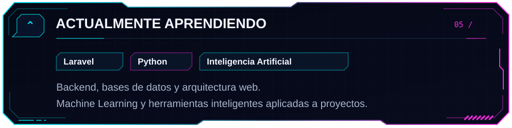

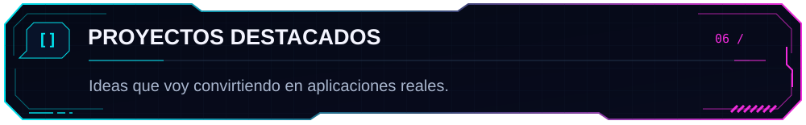

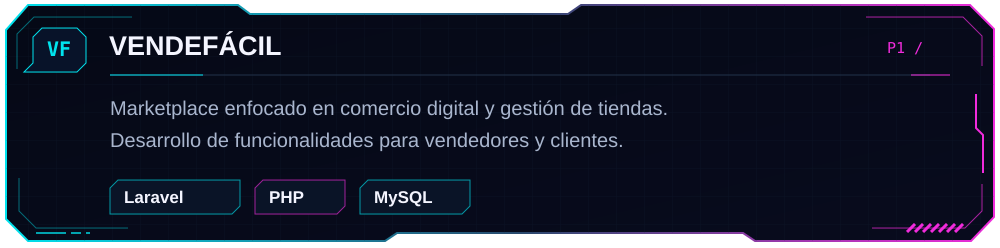

<a href="https://angeldev.infinityfreeapp.com">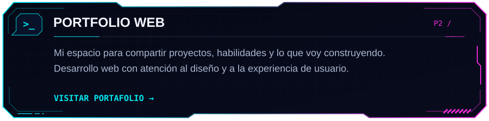</a>

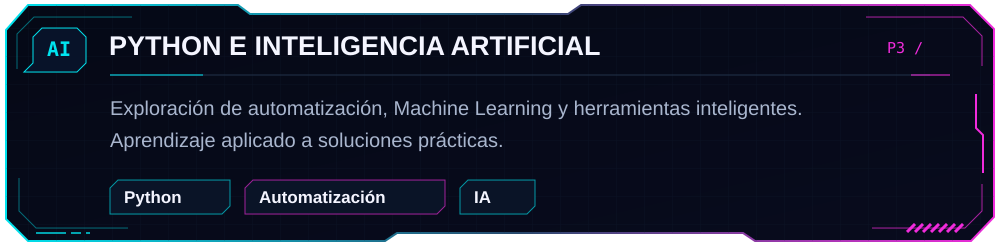



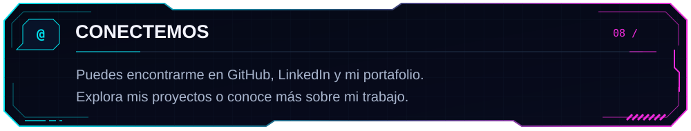

<a href="https://github.com/Angel-ETECH">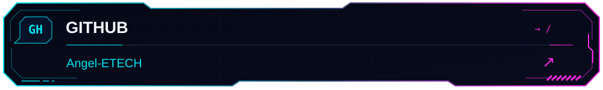</a>

<a href="https://www.linkedin.com/in/angelxc-gonzales">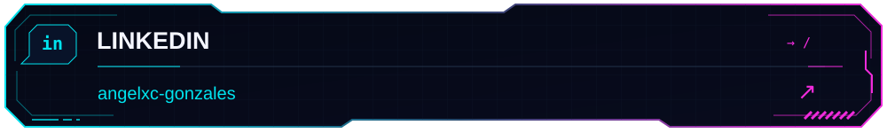</a>

<a href="https://angeldev.infinityfreeapp.com">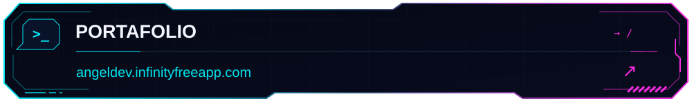</a>

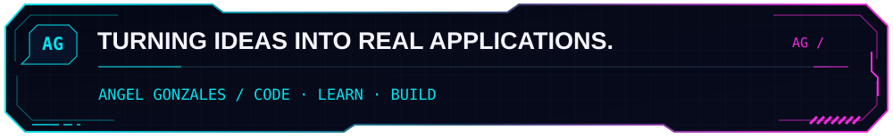

Leer presentación en texto

## Angel Gonzales

Desarrollador de software enfocado en aplicaciones web, backend, automatización e Inteligencia Artificial. Me gusta aprender construyendo proyectos y mejorándolos paso a paso.

### Enfoque y tecnologías

Desarrollo aplicaciones responsivas, paneles administrativos y flujos de usuario con Laravel, PHP, MySQL y JavaScript. También sigo aprendiendo Python, arquitectura web y Machine Learning.

Herramientas: HTML, CSS, JavaScript, PHP, Laravel, Python, Java, MySQL, Flask, TensorFlow, Git, GitHub y VS Code.

### Proyectos

- **VendeFácil:** marketplace enfocado en comercio digital, tiendas, vendedores y clientes.
- **[Portfolio Web](https://angeldev.infinityfreeapp.com):** mis proyectos y habilidades técnicas.
- **Python e IA:** exploración de automatización y herramientas inteligentes aplicadas a soluciones prácticas.

### Contacto

[GitHub](https://github.com/Angel-ETECH) · [LinkedIn](https://www.linkedin.com/in/angelxc-gonzales) · [Portfolio](https://angeldev.infinityfreeapp.com)

