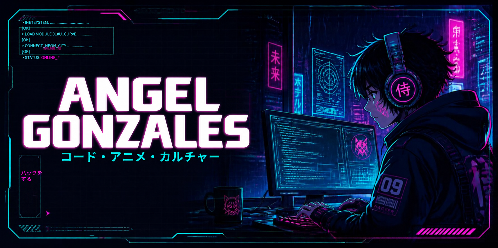

  

<h1 align="center">Hola 👋, soy Angel Gonzales</h1>

  <strong>Desarrollador de Software enfocado en aplicaciones web modernas, backend, automatización e Inteligencia Artificial.</strong>

  

---

## 👨‍💻 Sobre mí

Soy un desarrollador al que le gusta convertir ideas en aplicaciones útiles, con interfaces cuidadas y funcionalidades que resuelvan necesidades reales.

Me interesa el desarrollo web, los sistemas backend, la automatización y la Inteligencia Artificial. Aprendo construyendo proyectos y mejorándolos paso a paso.

- 💻 Desarrollo aplicaciones con **Laravel, PHP, MySQL y JavaScript**.
- 🛍️ Trabajo en **VendeFácil**, un proyecto de comercio digital.
- 🌱 Sigo aprendiendo **Laravel, Python e Inteligencia Artificial**.
- 🎨 Me gusta crear interfaces limpias, modernas y responsivas.
- 🌐 Puedes ver mis proyectos en mi [portafolio](https://angeldev.infinityfreeapp.com).

 

---

## 🚀 Enfoque profesional

- Desarrollo de aplicaciones web modernas y responsivas.
- Creación de sistemas con Laravel, PHP, MySQL y JavaScript.
- Implementación de funcionalidades backend, paneles administrativos y flujos de usuario.
- Exploración de Python, Machine Learning e Inteligencia Artificial.
- Diseño de interfaces funcionales y visualmente atractivas.

---

## 🛠️ Tecnologías y herramientas

  

---

## 📚 Actualmente aprendiendo

  
  
  
  

---

## 💼 Proyectos destacados

### 🛍️ VendeFácil

Marketplace enfocado en comercio digital, experiencia de usuario y gestión de tiendas. Un proyecto en el que desarrollo funcionalidades para vendedores y clientes.

### 🌐 Portfolio Web

Mi sitio personal para presentar proyectos, habilidades técnicas y lo que voy construyendo como desarrollador.

[Visitar mi portafolio →](https://angeldev.infinityfreeapp.com)

### 🤖 Proyectos con Python e IA

Exploración de automatización, Machine Learning y herramientas inteligentes aplicadas a soluciones prácticas.

---

## 📊 GitHub Stats

  
  

  

---

## 📬 Contacto

  
  
  

---

  <strong>Turning ideas into real applications.</strong>

  

